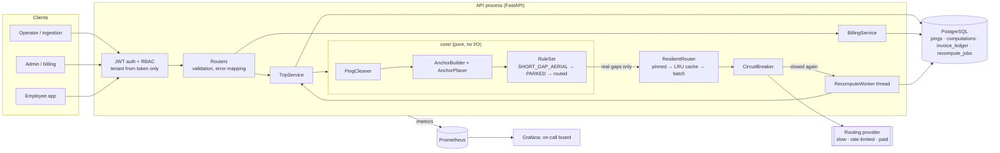

# Design note: billable distance reconstruction

## 1. Problem in one line

Turn an unreliable GPS stream plus trip milestones into a distance that both MoveInSync and
the vendor accept: correct when GPS is missing, robust when GPS is wrong, cheap on routing
calls, identical on every replay, and explained line by line.

## 2. Architecture



Layering: `api` (HTTP only) → `services` (transactions, idempotency, ledger) →
`core` (pure algorithm) and `persistence` (tenant-scoped repositories). `core` has no
dependency on the web framework, the database or the network, so every billing rule is a
plain unit test.

## 3. The algorithm

1. **Clean**, in a fixed order, each rejection counted by reason: invalid coordinates →
   outside the trip window → accuracy worse than 50 m → sort, de-duplicate by timestamp
   (keep the most accurate; ties broken by coordinates) → teleports above 120 km/h measured
   against the last *accepted* ping → stationary jitter under 8 m.
2. **Anchor**: employee pickup/drop (actual → profile home + sign-in time for ad-hoc →
   planned point + time for planned), optional no-show anchors, office anchor (actual trip
   end within 400 m, else planned office at trip-end time).
3. **Place anchors**: an anchor the GPS track already passes is redundant; a fallback anchor
   (planned time is untrusted) is retimed into the interval it fits at a legal speed, chosen
   by detour plus timing error; anchors are placed one at a time so two drops in one gap
   split it instead of colliding.
4. **Classify every segment** with the ordered rule set (vectorised with numpy, each rule
   claims the still-unclaimed segments): `SHORT_GAP_AERIAL` (< 70 s, plausible speed) →
   `PARKED` (≥ 70 s, < 5 km/h) → everything else is a real gap.
5. **Route real gaps in one batch**, judged as `ROUTED`, `REJECTED_MAX_DISTANCE` (> 100 km),
   `REJECTED_SPEED` (routed *and* aerial × 1.4 both too fast) or `DEGRADED_AERIAL`
   (provider unavailable → aerial × 1.4, trip marked DEGRADED).
6. **Round once**: each segment to whole metres (half-up), then exact integer sums. Metres
   become invoice kilometres in exactly one function (2 decimals, half-up).

## 4. Hardest flow: late pings after the invoice is closed

```mermaid
sequenceDiagram
    autonumber
    participant D as Device / ingestion
    participant API as API (TripService)
    participant DB as PostgreSQL
    participant W as RecomputeWorker
    participant E as Engine (core)
    participant R as ResilientRouter

    D->>API: POST /pings (late batch, maybe duplicated)
    API->>DB: INSERT … ON CONFLICT DO NOTHING (trip row locked)
    API->>DB: enqueue LATE_PINGS job, due = now + debounce (coalesces bursts)
    API-->>D: 202 accepted=n, duplicates=m
    W->>DB: peek (read-only) → claim job by compare-and-set (lease 60 s)
    W->>DB: load all pings + last COMPLETE route evidence
    W->>E: compute(evidence, pinned_routes)
    E->>R: only gaps not answered before
    R-->>E: distances (pinned / cache / provider)
    E-->>W: TripDistance (line items, fingerprint, watermark)
    W->>DB: BEGIN; lock trip; insert computation if fingerprint is new
    alt invoice CLOSED and result COMPLETE and watermark ≥ billed
        W->>DB: append ADJUSTMENT delta = new_total − balance
    else stale / degraded / same total
        W->>DB: no ledger change
    end
    W->>DB: COMMIT; mark job DONE
```

Why it is safe: the engine runs outside any transaction (provider latency never holds a
lock); the write is idempotent on `(trip, input_fingerprint, status)`; the ledger row is
unique per computation; a slower recompute on older evidence (lower ping watermark) can
never overwrite a newer one; a crashed worker's job is reclaimed when its lease expires.

## 5. Failure modes

| What fails | What the user sees | How the system recovers |
|---|---|---|
| Routing provider down / timing out | Trip computed immediately, status `DEGRADED`, affected gaps labelled `DEGRADED_AERIAL` (aerial × 1.4). Closing that invoice is refused (`DISTANCE_DEGRADED`). | Breaker opens after N failures so the provider is not hammered. Trip is queued; when the breaker closes, queued trips are released at once and recomputed to `COMPLETE`. |
| Provider returns garbage (NaN, negative, wrong length) | Same as down for that batch. | Treated as failure, never cached. |
| Provider rate-limits (429) / 5xx blip | Nothing. | One retry with backoff inside the HTTP client; a longer outage trips the breaker. |
| Duplicate or re-ordered ping delivery | Nothing. `duplicates` count in the ingest response. | Unique key on `(trip, ts, lat, lon)`; engine sorts and de-duplicates; property tests prove identical output. |
| Late pings after billing | A signed `ADJUSTMENT` entry (e.g. `+1.80 km`) with reason `LATE_PINGS`; the original entry is untouched. | Debounced recompute job; ledger append in the same transaction as the computation. |
| Worker crashes mid-job | Recompute is delayed by at most the lease (60 s). | Job is `RUNNING` with an expired lease → claimable again; the write is idempotent. |
| Two recomputes of one trip race | Nothing. | Trip row lock (Postgres) / `BEGIN IMMEDIATE` (SQLite); fingerprint uniqueness; watermark check. |
| Bad device fix (teleport burst) | Distance unchanged; `rejected_pings.TELEPORT` > 0. | Cleaning drops it; a long self-consistent run is accepted so one bad first fix cannot drop the trip. |
| Employee reported point invalid | Distance still sensible; anchor shows `PLANNED`/`PROFILE_HOME` source. | Fallback order from the spec; no valid point → `review_required` with `RIDER_WITHOUT_ANCHOR`. |
| Database unavailable | `500` with a request id; `/ready` fails so the orchestrator stops routing traffic. | Pool pre-ping reconnects; nothing is half-written (single transaction per step). |

## 6. Consistency, availability, latency

* **Availability over freshness for the estimate, consistency for money.** A provider outage
  never blocks ingestion or computation (we answer `DEGRADED`), but a degraded number can
  never be invoiced. Closed invoices only move by explicit, signed ledger entries.
* **Determinism over sharing.** The provider is only asked about snapped cell *centres*, so a
  cached answer cannot depend on which trip asked first. The route answers a trip was billed
  with are pinned and reused on its recomputes, so an invoice can be reproduced even after
  the road network (or provider) changes.
* **Latency.** The engine is ~2.7 ms per 1,500-ping trip; provider latency is paid at most
  once per trip (one batch) and never inside a DB transaction.

## 7. Data model (append-only where money is involved)

`trips` (evidence JSON, invoice status, billed watermark) · `pings` (raw, 1e-7° integers,
never updated) · `distance_computations` (every distinct result, with rule version, input
fingerprint, ping watermark, explained result; the map track in a deferred column) ·
`invoice_ledger` (ORIGINAL + signed ADJUSTMENTs, unique per computation) ·
`recompute_jobs` (PENDING/RUNNING/DONE/DEAD, lease, attempts, backoff).
